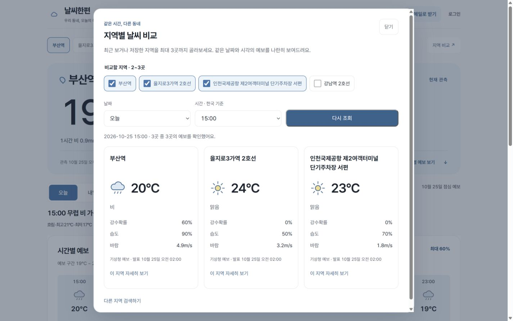
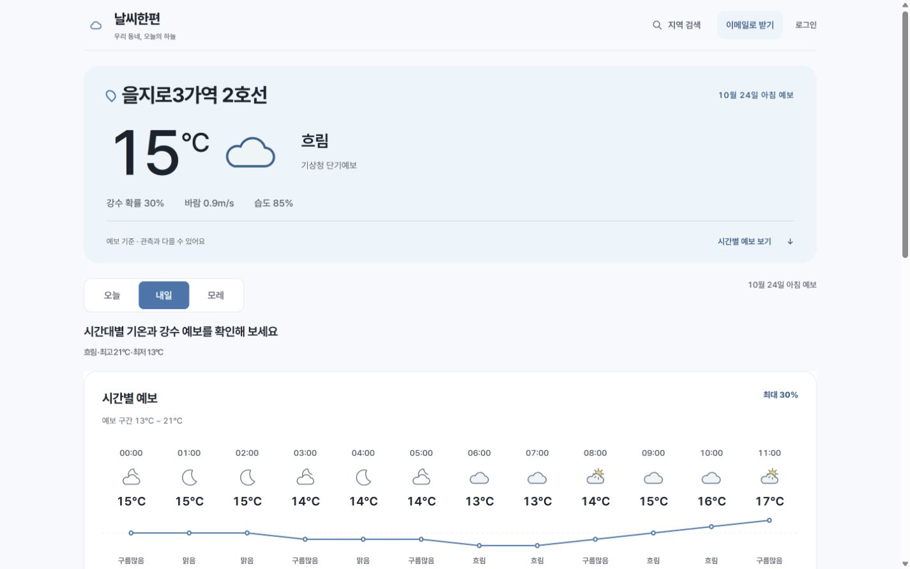
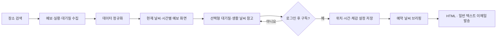
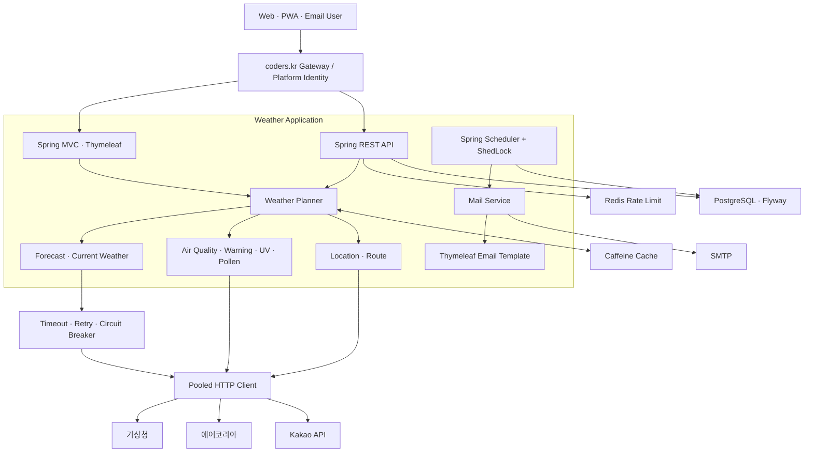

<h1 align="center">날씨한편</h1>

<p align="center">
  현재 관측과 시간별 예보를 지역별로 확인하고,<br>
  원할 때 날씨 이메일을 받아보는 생활 날씨 서비스
</p>

<p align="center">
  <a href="https://weather.coders.kr"></a>
  <a href="https://github.com/boclair98/Weather/actions/workflows/ci.yml"></a>
  
  
</p>

> 기상청·한국환경공단 에어코리아 원천자료를 활용하는 독립 서비스입니다. 기상청 공식 홈페이지나 인증·납품 제품을 의미하지 않습니다.

## 주요 기능과 최근 개선

### 2026-11-22 · 처음 방문과 모바일 검색 흐름

- **작은 화면의 지역 검색**: 짧은 화면이나 모바일 키보드가 열린 상태에서 하단 메뉴가 접혀도 상단 `지역 검색` 링크가 남습니다. 검색창은 화면을 채우고 결과는 한 영역에서 스크롤합니다. 검색을 닫으면 호출한 컨트롤 또는 현재 지역으로 키보드 초점을 돌립니다.
- **상태 안내 가독성**: 성공·오류·주의 안내의 의미 색을 라이트·다크 테마별 배경과 맞춰 대비를 높이고, 색상만으로 상태를 구분하지 않습니다.

### 2026-10-25 · 반복해서 쓰는 날씨 도구

- **최근 지역 복원과 빠른 전환**: 다시 방문하면 마지막 지역의 새 자료를 조회합니다. 공유 링크·구독 초안을 우선하며, PC는 바로가기, 모바일은 접이식 지역 메뉴를 제공합니다. 저장 장소는 이 브라우저에만 보관됩니다.
- **최대 3지역 비교**: 최근·관심지역 중 2~3곳을 고르고 오늘·내일·모레의 같은 한국 시각 예보를 비교합니다. 기온·강수확률·습도·풍속과 발표시각을 함께 보여줍니다. 정확히 일치하는 날짜·시각이 없으면 다른 시간의 값으로 대체하지 않습니다.
- **시간별 상세**: 시간별 항목을 누르거나 방향키·Enter로 열어 수치를 자세히 확인할 수 있습니다. Escape로 닫으면 원래 시간으로 포커스가 돌아옵니다.
- **조회 비용과 부분 실패**: 비교 창을 열기만 할 때는 API 요청이 없습니다. 비교 실행 시 최대 3개 요청, 기존 메모리 캐시 재사용, 닫기·날짜·시각·지역 변경 시 취소와 늦은 응답 무효화를 적용합니다. 한 지역의 실패가 다른 성공 결과를 지우지 않습니다.
- **날짜·저장소 오류 보완**: 한국 자정에 서버·브라우저 날씨 캐시를 구분합니다. 저장 예보는 같은 장소·절대 예보일·3시간 이내 조건을 모두 만족해야 재사용하며 저장 자료임을 표시합니다. 저장 공간 차단·손상에도 검색과 날씨 조회는 계속되고, 늦은 GPS 결과가 새 선택을 덮지 않습니다.
- **공기질·관측 정합성**: 1시간 PM 농도에는 에어코리아의 1시간 등급만 연결하며 등급 누락을 추정하지 않습니다. 관측시각과 지역명 일치/지역 대표 측정소 여부를 표시합니다. 강수 관측 누락을 무강수로 표시하지 않습니다.
- **모바일 장소 검색**: 지역 변경 시 전체 화면 검색을 열고, 입력·검색·최근 장소는 고정해 결과와 안내가 한 스크롤 영역에서 움직입니다. 검색 중에는 하단 빠른 메뉴를 숨겨 화면을 가리지 않으며, 첫 방문의 지역 선택 흐름은 그대로 유지합니다.
- **PWA 개인정보 보호**: 계정·인증·구독 HTML과 API 응답은 서비스워커 캐시에 저장하지 않습니다. 공개 자산만 저장하고 오프라인에는 개인정보 없는 연결 안내를 보여줍니다.

기존 Spring MVC·Thymeleaf·vanilla JavaScript를 유지했습니다. 새로운 외부 API 키·유료 서비스·프런트엔드 프레임워크는 필요하지 않습니다. 비교는 예보 조회이며 교통 경로나 공식 안전 판정이 아닙니다. 실제 처리 가능한 트래픽 규모는 부하 테스트 전까지 보장하지 않습니다.

지역·현재 기온·앞으로의 변화가 가장 먼저 읽히는 날씨 화면으로 다시 구성했습니다. 넓은 현재 날씨 영역과 정렬된 시간별 예보를 중심으로, 메일에서는 같은 자료를 짧은 날씨 편지로 전달합니다. 일부 자료가 없거나 요청 순서가 뒤바뀌어도 내용을 정확히 유지하는 것이 기준입니다.

| 영역 | 구현 내용 |
| --- | --- |
| 날씨 중심 화면 | 지역 → 큰 기온과 상태 → 강수·바람·습도 → 시간별 예보 → 일별 요약·공기질 순서입니다. PC는 넓은 관측 면과 하단 2열 요약, 모바일은 한 열로 구성하고 시간별 예보만 가로 탐색합니다. |
| 시간별 기온 흐름 | 실제 시간별 수치로 순수 SVG 선을 그립니다. 결측·중복·누락 시각은 선을 연결하지 않습니다. 12시간/전체 보기, 정확한 수치·강수확률·풍속 텍스트, 섭씨/화씨를 함께 유지합니다. 20~05시의 맑음·구름많음은 밤 아이콘으로 표시하며 일출·일몰이나 달의 위상을 계산한 결과는 아닙니다. |
| 탐색과 구독 | 보조 도구를 예보 아래로 옮기고 단위·테마·인쇄를 보기 설정에 모았습니다. 구독 전 로그인·본인 이메일 인증 절차를 안내하고, 로그인 이동 전 선택 지역과 알림 설정을 같은 탭의 임시 저장소에 보관합니다. 저장소가 차단돼도 로그인은 계속 가능합니다. |
| 수신 메일 | 날짜·예보 기준시각 → 한 문장과 기온 → 핵심 요약 → 앞으로의 예보 최대 6개 → 확인된 상세 → 날씨 보기·출처·알림 관리 순서입니다. 표와 인라인 스타일을 사용하며 일반 텍스트와 HTML을 MIME 대체본문으로 제공합니다. |
| 날짜·시간 | 메일의 대표 예보와 시간별 예보가 같은 날짜일 때만 결합합니다. `Asia/Seoul` 기준 발송 분보다 지난 예보는 제외하고, 오늘·내일·모레 제목과 예보 유효시각을 구분합니다. 대표 예보와 시간별 자료의 발표·조회 시각도 각각 표시합니다. |
| 부분 실패·경합 | 현재 관측·일별·시간별 예보를 독립적으로 조회하고 성공한 자료를 유지합니다. 지역 변경 시 이전 요청을 중단하고, 늦게 도착한 응답·오류·로딩 종료가 새 지역의 상태를 덮지 않도록 검사합니다. 펼치지 않은 상세 플래너는 조회를 지연합니다. |
| 결측 자료 | 누락을 20°C·0%·맑음으로 보완하지 않습니다. 시간별 숫자 필드는 `null`, 자료가 부족한 외출 점수는 `-1`, 비교 불가 시간대는 `UNAVAILABLE`로 표현하며 화면과 메일에는 자료 부족을 알립니다. |
| 이메일 인증 | 인증번호를 로그인 소유자·정규화한 이메일·번호에 묶어 해시하고, 해당 계정과 이메일의 챌린지만 조회합니다. 서로 다른 사용자의 6자리 번호가 같아도 구독 인증에 재사용할 수 없도록 격리합니다. |

새 뉴스 수집·생성형 모델·내일 날씨 생성 API를 추가하지 않습니다. 메일의 한 문장과 수치는 기존 예보 DTO에서 결정적으로 편집하며, 내일 자료가 없으면 변화 내용을 만들어 넣지 않습니다. 메일만의 추가 외부 호출도 늘리지 않고, 기존 시간별 예보 조회를 예보일에 맞는 `dayOffset`으로 사용합니다.

## 프로젝트 소개

날씨한편은 사용자가 선택한 지역의 현재 관측과 예보를 먼저 보여줍니다. 필요한 경우 대기질과 생활기상 정보를 확인하고, 로그인 후 이메일 구독을 설정할 수 있습니다.

### 제품 목표

- 지금 선택한 지역은 어떤 날씨인가?
- 오늘과 내일 기온·강수는 시간대별로 어떻게 달라지는가?
- 대기질·특보 같은 보조 정보가 있는가?
- 원할 때 로그인 계정에 연결된 이메일로 날씨를 받아볼 수 있는가?

기상청 관측·예보를 중심으로, 에어코리아 대기질과 장소 정보를 함께 제공합니다. 외출 시간·옷차림·생활안전 안내는 날씨 자료와 고정된 규칙으로 계산되는 선택형 참고 정보이며, 현재 날씨를 대신하거나 공식 예보를 의미하지 않습니다.

### 프로젝트 목표

1. 지역 선택 뒤 현재 관측과 시간별·일별 예보를 빠르게 보여줍니다.
2. 관측과 예보, 원천 출처와 발표·관측 시각을 구분합니다.
3. 대기질 등 선택형 부가 정보의 실패가 핵심 날씨 조회를 막지 않도록 합니다.
4. 로그인 계정에 연결된 이메일만 인증 후 구독하도록 보호합니다.
5. 예약 발송, 요청 급증, 외부 API 장애를 고려한 운영 구조를 유지합니다.

### 수익화까지 가는 제품 전략

현재 단계에서는 결제창이나 유료 배지를 붙이지 않습니다. 먼저 사용자가 지역별 날씨와 이메일 알림을 반복해서 쓰는지 검증하고, 이후 비용을 지불할 만큼 분명한 가치를 가진 기능만 상품화합니다.

| 단계 | 현재 제품에서 만드는 행동 | 확인할 지표 | 다음 판단 |
| --- | --- | --- | --- |
| 가치 경험 | 장소를 고르고 현재 관측·시간별 예보를 확인 | 장소 검색 성공 | 날씨 조회 완성도와 첫 화면 개선 |
| 활성화 | 이메일 인증 후 원하는 날씨 알림 시각을 설정 | 인증 및 구독 완료 | 구독 설정을 더 쉽게 만들기 |
| 습관 | 정해둔 시간에 개인화 브리핑을 받고 다시 방문 | 구독 유지·해지, 발송 성공률 | 반복 사용이 약하면 유료화보다 알림 품질 개선 |
| 수익화 준비 | 충분한 유지율이 확인된 사용자군에 고급 가치를 검증 | 코호트 유지율·유료 의향 | 장기 여행, 가족 위치 묶음, 전문 위험 알림 중 수요가 확인된 항목만 실험 |

핵심 흐름은 `지역 선택 → 현재 관측·예보 확인 → (선택) 이메일 인증 → 반복 수신`입니다. 운영 지표 `weather.product.funnel`은 고정된 단계·유입 태그만 기록하며 이메일, 계정 ID, 검색어, 좌표는 수집하지 않습니다.

## 제품 기획: 먼저 날씨, 필요할 때 보조 정보

### 한 줄 가치 제안

> **지역을 고르면 현재 날씨와 시간대별 변화를 바로 확인하고, 원하면 이메일로 받아봅니다.**

지역을 아직 고르지 않았을 때는 검색이 첫 화면의 중심입니다. 장소를 선택하면 검색은 지역 변경 창으로 물러나고 현재 관측과 예보가 가장 먼저 보입니다. 외출 시간·옷차림·생활안전 안내는 펼쳐서 보는 보조 정보이며, 날씨 데이터와 코드에 정의된 규칙으로 계산합니다. 생성형 AI 판단이나 공식 안전 지침을 가장하지 않습니다.

### 핵심 사용 루프

| 단계 | 사용자가 보는 것 | 제품 원칙 |
| --- | --- | --- |
| 1. 지역 | 동네·역·건물 검색, 현재 위치, 최근 장소 | 결과가 여러 개면 자동 선택하지 않고 정확한 장소를 직접 고르게 합니다. |
| 2. 현재 날씨 | 현재 관측 기온·상태·체감·강수·바람·관측 시각 | 실제 관측과 예보를 구분하며, 현재 자료를 불러오지 못해도 시간별 예보 접근을 유지합니다. |
| 3. 예보 | 오늘·내일·모레와 시간별 기온·강수, 대기질 | 현재 시각 이후의 시간만 앞으로의 예보로 제시하고 자료 출처·시각을 표시합니다. |
| 4. 선택형 안내 | 외출 시간·옷차림·생활안전 정보 | 점수·추천은 펼쳐서 보는 참고 정보이며 기상청의 공식 권고가 아닙니다. |
| 5. 이메일 | 로그인 → 본인 이메일 6자리 인증 → 구독 시각 선택 | 인증이 끝난 이메일만 계정에 연결하고, 로그인한 계정에서 구독을 변경·해지합니다. |

### UX 가드레일

- 지역 미선택 상태에서는 검색을 우선하고, 장소를 선택한 뒤에는 현재 날씨·시간별 예보를 검색보다 먼저 보여줍니다. 지역 변경은 검색 창을 열어 처리합니다.
- 검색 결과가 없는 상태, 여러 결과, 네트워크 오류에서 검색어를 유지해 다시 시도할 수 있습니다. 장소를 바꾸는 도중 기존 날씨는 새 장소를 확정하기 전까지 유지하며, 선택이 확정되면 새 장소 정보로 즉시 전환합니다.
- 모바일 지역 검색은 키보드가 열린 상태에서도 결과와 최근 장소를 탐색할 수 있는 하단 시트로 표시하며, 닫기·바깥쪽 탭·Esc 동작을 지원합니다.
- 장소를 잘못 고르는 실수를 막기 위해 Kakao 검색 결과에는 장소명과 행정/도로명 맥락을 함께 표시합니다.
- 구독은 Coders 플랫폼 로그인과 이메일 소유권 인증을 모두 통과해야 하며, 메일로 받은 6자리 번호가 맞을 때만 인증된 주소로 전송합니다.
- API 오류는 `Failed to fetch` 같은 브라우저 문구 대신 사용자가 다음에 할 행동(재시도·위치 재선택·로그인)을 안내합니다.
- 현재 날씨 카드에는 관측 기온·체감·강수·바람·실제 관측 시각을 표시하고, 시간별·일별 예보는 별도 영역으로 구분합니다.
- 데스크톱은 넓은 현재 날씨 → 시간별 예보 → 일별 요약·대기질 2열로 구성합니다. 모바일은 현재 기온에서 시간별 흐름으로 이어지는 한 열 구성이며, 시간별 예보만 가로로 탐색합니다.
- 시간별 예보는 한국 시간대 기준으로 지난 시각을 제외하며, 강수확률 자료가 없으면 0%로 꾸며내지 않고 자료가 없다고 표시합니다.
- 날씨 출처·예보 발표 시각과 관측 시각은 각각 원천 데이터에서 받은 값으로 표시하며, 서버 수집 시각을 관측 시각인 것처럼 보여주지 않습니다.

### 운영 품질 기준

기능을 많이 넣는 것보다 신뢰 가능한 판단을 빠르게 제공하는 것을 우선합니다. 그래서 외부 API별 timeout·retry·circuit breaker, 캐시·요청 제한, ShedLock 기반 중복 발송 방지, 데이터 신선도 라벨, 요청 추적 ID를 함께 운영합니다. 릴리스 전 `clean test bootJar`와 배포 후 실제 도메인 HTTP·브라우저 렌더링을 확인합니다.

## 주요 기능

| 영역 | 제공 기능 |
| --- | --- |
| 위치 검색 | 동네·역·건물 검색, 현재 위치, 최근·즐겨찾기 장소, 선택 후 지역 변경 시트 |
| 지역 비교 | 최대 3지역의 같은 날짜·시간 기온·강수확률·습도·풍속 비교, 개별 오류와 발표시각 |
| 현재 날씨 | 관측 기온·체감온도·습도·바람·강수량과 관측시각 |
| 시간별 예보 | 오늘부터 모레까지 기온·강수·습도·풍속, 비 시작·종료 예상, 가까운 12시간 우선 보기 |
| 대기질·생활기상 | 에어코리아 PM10·PM2.5, 자외선, 꽃가루, 공식 기상특보 (자료 제공 여부에 따라 표시) |
| 선택형 날씨 참고 | 시간별 예보를 기반으로 한 외출 시간·옷차림 안내; 산출 기준과 원천 수치를 함께 확인 |
| 이동·일정 | 출발지·목적지 날씨 비교, 비·바람이 덜한 시간, 캘린더 저장 |
| 날씨 이메일 | 사용자 본인 이메일 1개, 15분 유효 6자리 인증번호(오입력 5회 제한), 사용자 지정 시각(분 단위) 예약 발송, 스마트 위험 알림, HTML·일반 텍스트 날씨 편지 |
| 구독 관리 | 플랫폼 로그인 계정(UUID) 귀속, 인증 이메일 1개만 연결, 다음 예약 시각과 최근 5건의 성공·실패 확인, 알림 시각 변경, 해지, 개인정보 완전 삭제 |
| 웹 경험 | 미선택 시 검색 중심 화면, 선택 후 현재 날씨 중심 화면, 반응형 검색 시트, 시간별·일별 예보, 다크 모드, PWA 설치, 오프라인 안내 |

웹 화면은 Spring MVC·Thymeleaf를 유지하며 CSS 사용자 속성 기반 디자인 토큰, Grid/Flexbox, `clamp()` 유동형 타이포그래피, Pretendard Variable, 네이티브 `dialog`·`details`, 모바일 `dvh`와 안전 영역 여백, reduced-motion 대응을 사용합니다. 현재 날씨는 차분한 하늘빛 면으로 구분하고, 시간별 예보는 정렬된 수치와 SVG 기온 흐름이 하나의 가로 레일을 공유합니다. PM10·PM2.5는 측정값·단위·등급을 따로 표시합니다. 별도 프론트엔드 프레임워크·차트 라이브러리·추가 기상 API 호출이나 목업 데이터는 추가하지 않습니다.

## 서비스 미리보기

[운영 서비스 열기](https://weather.coders.kr) — 지역을 검색하면 실제 원천자료를 불러옵니다. 지역과 시각에 따라 화면의 기온·예보가 달라지므로 README에는 고정된 예시 수치를 현재 날씨처럼 표시하지 않습니다.

메일 본문은 모바일 수신을 기준으로 선택 지역의 예보·강수·대기질과 시간별 기상 정보를 한국어로 전달합니다. 메일은 반복적인 외출 점수·옷차림 문단을 걷어내고 실제 예보 중심의 편지로 정리했습니다. 외출·옷차림 참고 기능은 웹의 선택형 상세에서 유지합니다. 시간별 원천자료 조회가 실패해도 확인된 대표 예보를 유지하고 시간별 자료를 불러오지 못했다는 안내를 표시합니다. 숫자·시각·출처가 없는 항목은 없는 상태로 표시합니다.

`WeatherMailTemplateTest` 실행 시 `build/reports/weather-letter/` 아래 긴 주소·비·밤·결측·부분 실패·내일 예보의 HTML 검사본을 생성합니다. 검사본은 고정된 테스트 자료이며 운영 화면이나 실제 수신 성공의 증거가 아닙니다. 브라우저 렌더와 Gmail·Naver 등 실제 메일 클라이언트의 렌더 결과는 구분해서 확인해야 합니다.

### 지역 비교 화면 · 과거 로컬 검증 캡처 (2026-10-25)

촬영 당시 로컬 서버에서 실제 예보를 조회한 화면입니다. 현재 예보·현재 운영 화면을 뜻하지 않습니다. 날짜·시각 선택과 최대 3지역 비교는 기존 시간별 API에 연결되어 있습니다.



[모바일 비교 화면](docs/images/weather-compare-20261025-mobile.jpg) · [태블릿 비교](docs/images/weather-compare-20261025-tablet.jpg) · [시간별 상세](docs/images/weather-hour-detail-20261025-mobile.jpg) · [긴 지역명·360px 화면](docs/images/weather-workspace-20261025-small-mobile.jpg)

2026-10-25 로컬 검증: 전체 Java **164개 테스트 통과**(실패·오류·건너뜀 0), `test bootJar` 성공. 마지막 정적 자산 보완 후 `FrontendContractTest` 3개와 JAR 빌드도 재확인했습니다. JavaScript 검증 8종 통과: 요약 20 assertions, 차트 19 assertions, 상태경합 11·구독초안 3·위치/날짜 15·비교 13·신뢰성 13·서비스워커 23 회귀 케이스입니다.

로컬 H2·분리된 SMTP 환경에서 liveness/readiness `UP`, 실제 부산역 검색 15개 결과, 지역 전환·재방문 복원·오늘/내일 동일 시각 비교·4번째 지역 선택 차단·시간별 상세·방향키/Enter/Escape·포커스 복귀를 확인했습니다. 360×800·390×844·768×1024·1440×900 렌더와 긴 지역명에서 페이지/비교창 가로 넘침이 없었고, 다크 모드 버튼 대비도 확인했습니다. 최종 관련 콘솔 오류·경고는 없었습니다. 관측시각·지역 대표 측정소 기준은 새 백엔드 응답과 화면에서 확인했습니다.

부분 실패·GPS 경합·한국 자정·브라우저 저장소 차단·캐시 장애는 격리된 회귀 테스트로 재현했습니다. 실제 휴대폰·키보드·글자 확대, 운영 SSO 왕복·Gmail/Naver 수신, 프린터 출력·트래픽 부하·운영 배포는 이번 확인 범위가 아닙니다. 오프라인 안내는 브라우저 렌더와 서비스워커 VM 테스트를 구분해 검증했습니다.

### 이전 디자인 기록 · 로컬 캡처 (2026-10-23)

아래 이미지는 이전 UI를 비교하기 위해 남긴 기록입니다. 웹 화면은 촬영 당시 로컬 실행에서 자료를 조회했으며 현재 운영 화면과 다를 수 있습니다. 메일 이미지는 고정 예시 자료의 브라우저 렌더링이지 실제 수신함의 증거가 아닙니다.



[390px 모바일](docs/images/weather-observatory-mobile.jpg) · [360px 모바일](docs/images/weather-observatory-small-mobile.jpg) · [태블릿](docs/images/weather-observatory-tablet.jpg) · [일별 요약·공기질](docs/images/weather-observatory-details.jpg) · [구독 안내](docs/images/weather-observatory-subscribe.jpg) · [모바일 메일 디자인 검사본](docs/images/weather-letter-20261023-mail.jpg)

로컬 검증: `gradlew.bat test bootJar --no-daemon` 성공(152개 테스트, 실패·오류·건너뜀 0). 날씨 요약 JavaScript 20개 assertion, 차트·단위 변경·밤 아이콘 19개 assertion, 비동기 상태 11개 회귀 케이스, 로그인 초안 복원·손상·저장소 차단 3개 케이스가 통과했습니다. Liveness·readiness 모두 `UP`입니다. 브라우저의 360×800·390×844·768×1024·1440×900에서 가로 넘침 없이 렌더링됐으며, 실제 장소 검색·선택·빈 결과·날짜 전환·12/24시간 보기·메일형 보기·섭씨/화씨·테마 전환과 닫기 후 포커스 복귀를 확인했습니다. 긴 장소명과 390×460의 낮은 검색 화면도 확인했습니다. 관련 콘솔 오류·경고는 없었습니다.

운영 DB와 SMTP는 연결하지 않았습니다. 실제 운영 로그인 왕복, Gmail·Naver 수신, 실제 휴대폰 키보드·글자 확대, 프린터 출력, 부하 테스트는 별도 검증이 필요합니다. 로그인 초안 복원은 격리 테스트이며 운영 SSO 검증을 대신하지 않습니다. 화면 폭을 줄인 검사는 실제 기기 키보드 검사나 트래픽 처리량 측정을 대신하지 않습니다.

## 사용자 흐름



## 시스템 아키텍처



## 핵심 기술 설계와 해결한 문제

### 1. 외부 API 장애가 전체 날씨 조회로 번지는 문제

**문제**

기상청·에어코리아·Kakao처럼 응답 특성이 다른 외부 API를 한 요청에서 사용하면, 한 공급자의 지연이 전체 응답 지연과 스레드 고갈로 이어질 수 있습니다.

**선택과 구현**

- 공급자 호출을 bounded executor에 격리하고 시도별 제한시간을 적용했습니다.
- 실패한 호출은 120ms backoff 후 한 번만 재시도합니다.
- 연속 3회 실패하면 해당 공급자의 회로를 30초간 열어 불필요한 대기를 줄입니다.
- 예보·실황은 최대 2시간 이내의 마지막 정상자료만 `STALE_FALLBACK`으로 명시해 제공합니다.
- 부가 안전정보가 실패해도 핵심 날씨 응답은 가능한 범위에서 계속 구성합니다.

**결과**

외부 장애를 정상 데이터처럼 숨기지 않으면서도, 일부 공급자의 실패가 서비스 전체 실패로 번지는 범위를 줄였습니다.

### 2. 서로 다른 데이터의 시각과 품질을 설명하기 어려운 문제

**문제**

예보 발표시각, 실제 관측시각, 서버 수집시각이 서로 다른데 이를 구분하지 않으면 사용자는 오래된 값을 최신 정보로 오해할 수 있습니다.

**선택과 구현**

- 응답에 출처·발표시각·수집시각·완전성·fallback 여부를 포함했습니다.
- 기관 연계 API는 `X-Data-Freshness`, `X-Data-Quality`, `X-Schema-Version`, `X-Request-Id` 헤더를 제공합니다.
- 위험 요인은 코드·심각도·점수 영향·근거·행동으로 분리해 영향도 순으로 전달합니다.

**결과**

화면과 API 소비자가 추천 문구뿐 아니라 데이터 상태와 판단 근거를 함께 확인할 수 있습니다.

### 3. 서버가 여러 대일 때 예약 메일이 중복 발송되는 문제

**문제**

모든 인스턴스에서 같은 스케줄러가 실행되면 동일 시간대 메일이 중복 발송될 수 있고, 위험 알림은 같은 상황을 반복해서 보낼 수 있습니다.

**선택과 구현**

- ShedLock과 데이터베이스 시간을 사용해 사용자 지정 시각을 확인하는 작업을 인스턴스 중 하나만 수행하도록 했습니다.
- 예약 작업은 매분 실행되지만 해당 분에 발송할 사용자만 복합 인덱스로 조회하고, 사용자별 날짜 슬롯 claim으로 중복 발송을 방지합니다.
- 기존 아침 06:30·점심 11:30·저녁 18:30 기본값은 마이그레이션에서 보존해 기존 구독자의 동작을 바꾸지 않습니다.
- 스마트 알림은 날짜·시간대·위험 조합 fingerprint를 저장해 같은 위험의 반복 발송을 줄였습니다.
- 메일 성공·실패 결과는 별도 트랜잭션으로 이력에 기록해 발송 작업 실패와 이력 저장을 분리했습니다.
- 실제 SMTP 전송은 bounded 비동기 executor로 처리합니다.

**결과**

다중 인스턴스 환경의 예약 작업 충돌을 줄이고, 수신자가 같은 위험 메일을 반복해서 받는 상황을 완화했습니다.

### 4. 트래픽 증가가 외부 연동과 서버 자원을 고갈시키는 문제

**문제**

날씨가 급변하거나 특보가 발표되면 같은 지역 조회가 몰리고, 외부 API 연결과 애플리케이션 스레드가 동시에 소진될 수 있습니다.

**선택과 구현**

- Caffeine 캐시에 최대 크기와 만료시간을 설정해 동일 위치의 중복 계산을 줄였습니다.
- Apache HttpClient connection pool을 전체 200개, 공급자 경로별 50개로 제한했습니다.
- 읽기·쓰기 요청 제한을 분리하고 운영에서는 Redis로 인스턴스 간 카운터를 공유합니다.
- Redis가 300ms 안에 응답하지 않으면 bounded 로컬 제한기로 전환해 요청 경로에서 격리합니다.
- 메일·외부 API·플래너 작업은 각각 용량이 제한된 executor로 분리했습니다.

**결과**

외부 시스템이나 보조 인프라가 느려질 때 애플리케이션 자원이 무제한으로 대기하지 않도록 경계를 만들었습니다.

### 5. 로그인 계정과 이메일을 안전하게 연결하는 문제

**문제**

이메일 주소만으로 구독을 만들거나 수정하면 임의의 주소를 입력하거나 타인의 구독을 변경할 수 있습니다. 또한 Coders 인증 게이트웨이는 애플리케이션에 계정별 pairwise UUID를 제공하지만 원문 계정 이메일 주소를 노출하지 않습니다.

**선택과 구현**

- 운영 환경에서는 검증된 `X-Coders-User`가 없으면 구독·관리 API를 거부합니다.
- 로그인한 UUID를 `ownerId`로 저장하고 소유권이 다른 계정의 변경을 차단합니다.
- 구독 전 15분 유효 이메일 인증 챌린지를 발급하고, 메일로 보낸 6자리 번호를 입력해 일치할 때만 해당 `ownerId`에 일회성으로 연결합니다. 새 번호를 요청하면 이전 번호는 즉시 폐기되고, 5회 틀리면 해당 챌린지를 잠급니다. 재전송은 30초 쿨다운과 API `429 Retry-After`로 남용을 막습니다.
- 구독 요청의 이메일과 인증 챌린지의 이메일이 다르면 서버에서 거부하며, 새 인증번호는 `ownerId`·정규화한 이메일·번호를 함께 SHA-256 해시로 저장하고 구독에 사용한 즉시 폐기합니다. 계정·이메일 범위 안에서만 챌린지를 조회하므로 다른 사용자가 같은 6자리 번호를 받아도 충돌하지 않습니다. 이미 발급된 구버전 번호는 기존 15분 유효기간 동안 해당 계정·이메일 범위에서만 호환합니다.
- 이메일 주소만 입력해서 타인의 구독을 해지하는 공개 UI는 제공하지 않습니다. 로그인한 계정의 관리 화면과 수신 메일의 해지 링크를 제공하며, 개인정보 완전 삭제에는 계정 소유권 확인이 필요합니다.
- 개인정보 동의 버전과 동의시각, 구독 해지시각을 저장합니다.
- 로그인 사용자는 구독과 메일 발송 이력을 함께 완전 삭제할 수 있습니다.
- 원문 이메일 대신 내부 사용자 ID를 운영 로그에 남깁니다.

**결과**

공개 날씨 조회와 개인 구독 관리를 분리하고, 계정 UUID·이메일 소유권 인증·단일 연결 정책을 함께 적용했습니다.

## 기술 스택

| 영역 | 기술과 선택 이유 |
| --- | --- |
| Language | Java 17 |
| Backend | Spring Boot 3.5.16, Spring MVC, Validation |
| View | Thymeleaf, HTML, CSS, Vanilla JavaScript |
| Persistence | Spring Data JPA, PostgreSQL, Flyway · 로컬 H2 · MySQL 드라이버 |
| Cache | Caffeine, Redis |
| Scheduling | Spring Scheduler, ShedLock |
| Integration | Apache HttpClient 5, 기상청·에어코리아·Kakao·SMTP |
| Observability | Actuator, Micrometer, Prometheus, request ID |
| Test | JUnit 5, AssertJ, Mockito, Spring Boot Test |
| Delivery | Docker, GitHub Actions, dependency review, CycloneDX SBOM |

### 생성형 AI 기능 점검 범위

제품 코드에서 AI 채팅·모델 API·프롬프트 호출 경로를 찾지 못했습니다. 웹의 날씨·장소 요청과 예약 이메일은 기존 Spring 서비스 및 기상청·에어코리아 연동을 사용합니다. 외출 시간, 위험 안내, 옷차림은 기상 데이터와 고정된 코드 규칙에 따른 선택형 참고 정보이며, 생성형 AI가 작성한 결과가 아닙니다. 이 재설계에서는 없는 모델 연동을 제거했다고 주장하지 않으며, 실제 호출이 확인되지 않은 서버 기능은 삭제하지 않았습니다.

웹은 한글 글꼴로 Pretendard Variable을 사용하고, 버전을 고정한 공식 배포 CSS/WOFF2를 jsDelivr에서 비동기로 가져옵니다. CDN을 사용할 수 없는 경우 시스템 한글 글꼴로 이어서 표시합니다. [Pretendard 공식 저장소](https://github.com/orioncactus/pretendard)와 SIL Open Font License 1.1을 따릅니다.

## 주요 API

| Method | Endpoint | 설명 |
| --- | --- | --- |
| `GET` | `/api/weather/current` | 현재 관측 날씨 |
| `GET` | `/api/weather/daily` | 시간대별 개인화 날씨 |
| `GET` | `/api/weather/hourly` | 선택 날짜의 시간별 예보와 출처·발표·조회 시각; 결측 숫자는 `null` |
| `GET` | `/api/weather/planner` | 일정 주변의 추천 시간대 |
| `GET` | `/api/v1/weather/briefing` | 버전 고정 기관 연계 브리핑 |
| `GET` | `/api/locations/search` | 장소 검색 |
| `GET` | `/api/routes/briefing` | 출발지·목적지 날씨 비교 |
| `POST` | `/api/users/email-verification/request` | 로그인 계정에 연결할 이메일 인증 메일 요청 |
| `POST` | `/api/users/email-verification/confirm` | 메일로 받은 6자리 인증번호 대조(일치할 때 승인) |
| `GET` | `/api/users/email-verification/confirm` | 구버전 링크 메일 호환용(새 메일은 인증번호 방식) |
| `POST` | `/api/users/subscribe` | 로그인 계정에 날씨 구독 연결 |
| `GET` | `/api/users/me` | 현재 계정의 구독 조회 |
| `GET` | `/api/users/me/delivery` | 본인에게 예정된 다음 정기 메일과 최근 발송 5건 조회(로그인 필수, 캐시 금지) |
| `PATCH` | `/api/users/me/notifications` | 알림 여부와 한국 시간 기준 분 단위 발송 시각 변경 |
| `DELETE` | `/api/users/me/data` | 구독과 개인정보 완전 삭제 |

`/api/users/subscribe`는 운영 환경에서 `X-Coders-User`와 이메일 인증번호(`verificationCode`)를 모두 요구하며, 인증된 이메일 하나만 받습니다. 이전 링크 인증 클라이언트의 `verificationToken`도 호환성을 위해 당분간 허용합니다. 인증번호 재전송을 30초 안에 다시 요청하면 `429 VERIFICATION_COOLDOWN`과 `Retry-After`가 반환됩니다. `/api/users/me/notifications`의 알림 시각 필드는 `HH:mm` 형식의 `morningTime`, `afternoonTime`, `eveningTime`입니다. 운영 스케줄러는 매분 해당 시각의 사용자만 조회하고, 한국 표준시(`Asia/Seoul`)로 발송합니다. 다음 발송 예정 시각은 정기 메일만 계산하며 스마트 위험 알림은 발생 조건에 따라 별도로 전송됩니다.
오류 응답은 `application/problem+json`과 요청 추적 ID를 사용합니다. 상세 계약은 [API 계약](docs/API_CONTRACT.md)에서 확인할 수 있습니다.

## 프로젝트 구조

```text
src/main
├── java/com/example/WebSideProject
│   ├── config       # 보안 헤더, 요청 제한, HTTP client, cache, scheduler lock
│   ├── controller   # 웹·날씨·위치·경로·구독·기관 API
│   ├── dto          # 외부 응답과 공개 API 계약
│   ├── entity       # 구독 사용자와 메일 발송 이력
│   ├── event        # 구독 직후 비동기 메일 이벤트
│   ├── repository   # JPA repository
│   ├── scheduler    # 정기 브리핑과 스마트 위험 알림
│   └── service      # 날씨 수집·정규화·판단·메일 발송
└── resources
    ├── db/migration # PostgreSQL Flyway migration
    ├── static       # weather-letter.js/css, PWA manifest, service worker, favicon
    └── templates    # 반응형 웹 UI와 HTML 메일
```

## 테스트와 배포 품질

Pull Request와 `main` push에서 다음 검사를 자동 수행합니다.

- Gradle wrapper 검증
- 단위·통합 테스트와 실행 JAR 생성
- 운영 Docker 이미지 빌드
- 새 의존성의 고위험 취약점 검사
- 컨테이너 CycloneDX SBOM 생성

운영 상태는 liveness·readiness probe, Actuator, Prometheus 지표로 확인합니다. 상세 장애 대응과 롤백 절차는 [운영 런북](docs/OPERATIONS.md)에 기록했습니다.

### 검증 명령과 확인 범위

아래 명령은 재현 가능한 로컬 검증입니다. 과거 실행 결과는 날짜와 로컬 범위를 함께 기록하며, 브라우저 확인과 실제 운영 인증·메일·트래픽 검증은 구분합니다.

실행 중인 로컬 미리보기가 있다면 먼저 종료한 뒤 `clean`을 실행하세요. 빌드 폴더 정리는 실행 중인 미리보기 JAR도 제거할 수 있습니다.

```powershell
.\gradlew.bat clean test bootJar --no-daemon
node scripts/test-weather-letter.cjs
node scripts/test-weather-state.cjs
node scripts/test-weather-chart.cjs
node scripts/test-subscription-draft.cjs
node scripts/test-weather-workspace.cjs
node scripts/test-weather-compare.cjs
node scripts/test-weather-reliability.cjs
node scripts/test-weather-worker.cjs
```

Node.js는 검증 스크립트를 실행할 때만 필요하며 새 프런트엔드 빌드 의존성은 없습니다. `test-weather-letter.cjs`는 실제 `weather-letter.js`의 결측·0값·부분 강수 자료·날짜별 문구를 검사합니다. `test-weather-state.cjs`는 실제 화면의 조회 함수를 격리해 지역 변경 경합, 늦은 성공·오류·로딩 종료, 독립 조회의 부분 실패와 플래너 지연 조회를 재현합니다. `test-weather-chart.cjs`는 선 연결·결측·시간 공백·단위 변경·밤 아이콘을, `test-subscription-draft.cjs`는 실제 로그인 클릭 리스너와 초안 저장·복원 함수를 검사합니다. `test-weather-workspace.cjs`는 좌표·날짜·스냅샷, `test-weather-compare.cjs`는 실제 비교 리스너의 상한·취소·부분 실패, `test-weather-reliability.cjs`는 실제 지역 선택·GPS·저장소·캐시·관측 문구, `test-weather-worker.cjs`는 실제 서비스워커의 캐시 격리·오프라인·저장 실패를 검사합니다. 여덟 스크립트는 네트워크·DB·SMTP를 사용하지 않으며 실제 브라우저 조작을 대신하지 않습니다.

- 자동 테스트는 날씨 응답의 결측·부분 실패, 지역 변경 중 늦은 응답, 이메일 인증 소유권·쿨다운, 시간대 경계, 메일 템플릿과 서비스워커의 비공개 응답 캐시 차단을 확인합니다.
- 현재 로컬 UI 검증과 이번 운영 배포 결과는 날짜·환경을 나누어 기록합니다. 운영 로그인 왕복, 실제 메일 수신함, 실기기 키보드·글자 확대, 프린터 출력 및 부하 시험은 별도 운영 검증이며 자동 테스트로 대신하지 않습니다.

### 반응형 검증 체크리스트

- `360×800`, `390×844`, `768×1024`, `1440×900`에서 가로 넘침·잘림·고정 메뉴 겹침 확인
- 지역 검색, 날씨 로딩, 추천 시간 알림 설정, 이메일 인증, 성공·오류 상태 확인
- 키보드 초점, 폼 레이블, 44px 이상 모바일 터치 영역, 한국어 줄바꿈 확인
- 브라우저 콘솔 오류와 실패한 애플리케이션 요청 확인

`/actuator/health`의 `weatherApi` 상태는 원천 날씨 API 키가 없으면 `DOWN`, 외부 연동 키가 일부 없거나 KMA 회로 차단기가 열리면 `DEGRADED`로 표시합니다. 상태 상세에는 누락된 환경변수 이름만 표시하며 키 값은 노출하지 않습니다.

## 로컬 실행

### 요구사항

- Java 17
- 전체 기능 사용 시 기상청·에어코리아·Kakao API 키와 SMTP 계정
- 운영 구성 사용 시 PostgreSQL과 Redis

```powershell
git clone https://github.com/boclair98/Weather.git
cd Weather
.\gradlew.bat clean test bootJar --no-daemon
.\gradlew.bat bootRun
```

기본 개발 환경은 인메모리 H2를 사용합니다. 외부 API 키는 저장소에 커밋하지 않고 환경변수로 주입하며, 전체 목록은 [.env.example](.env.example)을 참고하세요.

### 환경변수

| 이름 | 용도 | 필수 | 발급·준비 위치 |
| --- | --- | --- | --- |
| `WEATHER_API_KEY` | 기상청 예보·실황 | 운영 필수 | 공공데이터포털 기상청 단기예보 조회서비스 |
| `AIR_QUALITY_API_KEY` | 에어코리아 PM10·PM2.5 | 선택 | 공공데이터포털 한국환경공단 대기오염정보 |
| `KAKAO_REST_API_KEY` | 동네·역·건물 검색 | 운영 권장 | Kakao Developers 애플리케이션 REST API 키 |
| `WEATHER_WARNING_API_KEY` | 기상특보 | 선택 | 공공데이터포털 기상청 특보 API |
| `LIVING_WEATHER_API_KEY` | 자외선 등 생활기상 | 선택 | 공공데이터포털 생활기상지수 API |
| `POLLEN_API_KEY` | 꽃가루 위험 | 선택 | 공공데이터포털 꽃가루농도위험지수 API |
| `KAKAO_MOBILITY_REST_API_KEY` | 이동 경로 보조 | 선택 | Kakao Developers Mobility 권한 |
| `SMTP_HOST`, `SMTP_PORT`, `SMTP_USERNAME`, `SMTP_PASSWORD` | 인증번호·날씨 메일 발송 | 구독 기능 필수 | 사용하는 SMTP 공급자, Gmail은 앱 비밀번호 |
| `DB_URL`, `DB_USERNAME`, `DB_PASSWORD` | 운영 구독·발송 이력 저장 | 운영 필수 | PostgreSQL/MySQL 인스턴스 |
| `REDIS_URL` | 다중 인스턴스 요청 제한 | 운영 권장 | Redis 인스턴스 |
| `ADMIN_API_KEY` | Prometheus·metrics 보호 | 운영 필수 | 직접 생성한 긴 무작위 값 |
| `APP_BASE_URL` | 메일과 리다이렉트 기준 URL | 운영 필수 | 배포 도메인 |

### 데이터베이스

로컬 기본 프로필은 H2를 자동 사용합니다. 운영 프로필에서는 `DB_URL`·`DB_USERNAME`·`DB_PASSWORD`를 설정하면 Flyway가 `src/main/resources/db/migration`을 순서대로 적용합니다. Coders.kr 구성은 PostgreSQL을 사용하며, 임의로 운영 테이블을 초기화하지 않습니다.

## 저장소와 배포

- 원본 저장소: [boclair98/Weather](https://github.com/boclair98/Weather)
- 조직 포크: [coders-kr/Weather](https://github.com/coders-kr/Weather)
- 배포 소스: 원본 저장소의 실제 기본 브랜치
- 운영 서비스: [weather.coders.kr](https://weather.coders.kr)

업데이트는 로컬 테스트와 비밀정보 검사를 통과한 커밋을 원본 저장소에 먼저 푸시하고, 실제 GitHub 포크인 조직 저장소를 `gh repo sync coders-kr/Weather -b main`으로 동기화한 다음 원본 저장소에서 Coders.kr 재배포를 수행합니다. 배포 후에는 health와 실제 화면을 모바일·태블릿·데스크톱에서 다시 확인합니다. Coders.kr API 형식은 변경될 수 있으므로 배포 직전에 `https://coders.kr/llms.txt`의 최신 지침을 확인합니다.

## 운영 문서

- [API 계약](docs/API_CONTRACT.md)
- [운영 런북](docs/OPERATIONS.md)
- [개인정보 처리 설계](docs/PRIVACY.md)
- [기관 도입 준비 범위](docs/PUBLIC_SECTOR_READINESS.md)
- [제품 로드맵](docs/PRODUCT_ROADMAP.md)
- [보안 정책](SECURITY.md)
- [기여 방법](CONTRIBUTING.md)

## 현재 범위와 한계

- 예보와 관측은 원천기관의 갱신 주기·정확도·호출 제한에 영향을 받습니다.
- 위험 상황에서는 서비스 추천보다 기상청 공식 특보와 관계기관 지침을 우선해야 합니다.
- 현재 계정 인증은 Coders 플랫폼의 SSO 로그인 화면을 사용합니다. 플랫폼은 앱에 원문 이메일 대신 프로젝트별 UUID만 전달하므로, 첫 구독에는 15분 유효 6자리 이메일 인증번호 입력이 필요합니다. Naver·Kakao 로그인은 공급자가 신뢰 가능한 이메일 claim을 제공하는지 확인한 뒤 추가할 예정입니다.
- 외출 시간창 버튼은 오늘의 추천 시각으로 매일 같은 발송 시간을 설정합니다. 예보가 바뀔 때마다 발송 시각을 다시 계산하는 방식은 아직 제공하지 않습니다.
- 성능 관련 항목은 자원 고갈을 막기 위한 구조적 경계이며, 공개된 대규모 부하 시험 수치를 의미하지 않습니다.
- 현재 결제·유료 요금제·메일 열람 추적은 구현하지 않았습니다. 개인정보를 늘려 수집하지 않고 반복 사용과 구독 유지가 검증된 뒤 수익화 실험을 진행합니다.
- 별도 라이선스 파일이 없어 재사용 권한은 명시적으로 부여되지 않았습니다. 사용·배포 전 저장소 소유자에게 확인해야 합니다.

---

<p align="center">
  <strong>날씨한편은 지역의 현재 날씨와 앞으로의 예보를 쉽게 확인할 수 있도록 돕습니다.</strong>
</p>
